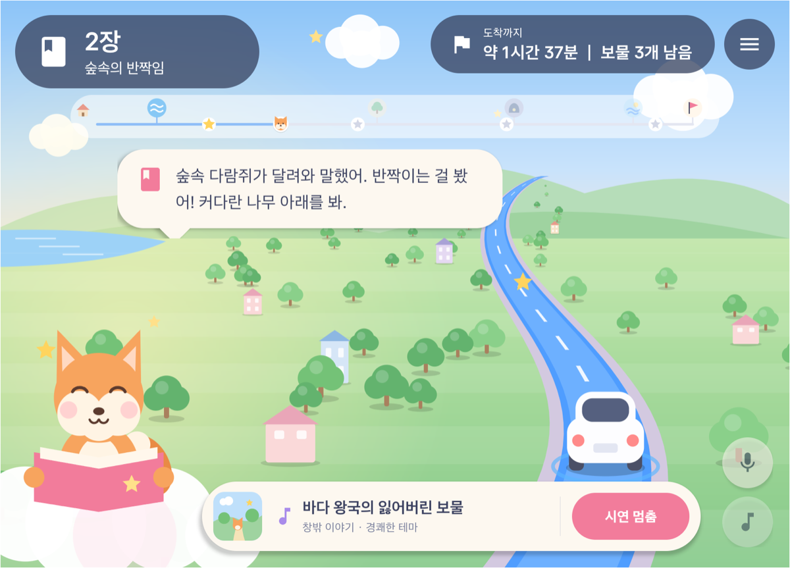

# 창밖 이야기

**오늘 달리는 경로가 한 편의 동화가 되어, 남은 시간만큼 이야기가 이어지고 목적지에 도착하는 순간 결말을 맺는 뒷좌석 아이용 오디오 동화 앱입니다.**

현대자동차그룹 차량용 앱 개발 공모전 출품작이며, Pleos Connect(Android Automotive OS)용 앱입니다. 팀명은 **창가자리**입니다.



- 공식 안내: https://appdevchallenge.auto-hmg.io/

## 한눈에 보기

| 항목 | 내용 |
|---|---|
| 앱 이름 | 창밖 이야기 (패키지 `com.changbak.story`) |
| 한 줄 소개 | 이동 시간을 이야기 한 편으로 바꿔, "언제 도착해?"에 "바다 보물 두 개만 더 찾으면 도착해!"라고 답하는 앱 |
| 주 사용자 | 3~9세 아이(뒷좌석). 운전자는 주행 중 조작할 것이 없음 |
| 이야기 | 「바다 왕국의 잃어버린 보물」 4장. 아이는 탐험 대장, 여우 루루는 길잡이. 장마다 바다 보물 하나를 찾음 |
| 사용 SDK | Vehicle 2.3.2, NaviHelper 3.0.5, TextToSpeech 3.3.1, SpeechToText 3.3.1, FusedLocation 1.1.3 |
| **APK 위치** | [`apk/창가자리_창밖이야기_release.apk`](apk/창가자리_창밖이야기_release.apk) (release, v3 서명, 약 29MB) |

## 어떤 앱인가요

| 기능 | 설명 |
|---|---|
| 경로가 이야기가 됨 | 내비게이션의 예상 소요 시간으로 이야기를 4장으로 나누고, 경로 진행률에 맞춰 장을 진행합니다. 도착하는 순간 결말이 나옵니다. |
| 창밖 퀘스트 | "빨간 트럭을 찾아 줘"처럼 창밖을 보게 하는 과제를 내고, 아이는 **목소리로** 답합니다(SpeechToText). |
| "얼마나 남았어?" | 남은 시간을 남은 보물 수로 바꿔 음성으로 답합니다. 화면 위 진행선에도 남은 보물이 보입니다. |
| 안전벨트 연동 | 주행 중 벨트를 풀면 이야기가 멈추고, 다시 매면 이어집니다. 계속 안 매면 운전자에게 음성으로 알립니다. |
| 휴게소 | 경유지에 도착하면 쉬어 가는 장면 뒤 이야기를 멈추고, 다시 출발하면 이어 갑니다. |
| 장소 장면 | 강, 터널, 바다 같은 장소에서 장면과 효과음이 나옵니다. |
| 주행 중 조작 없음 | 주행 중에는 누르는 버튼이 없습니다. 음악 취향 설정은 정차(P단)에서만 열립니다. |
| AI 테마곡 | 테마곡은 Suno로 만든 곡입니다. 음악 취향(분위기, 빠르기, 악기)을 고르면 Suno 생성 요청문이 만들어집니다. |

## 실행 방법

### A. APK로 설치 (가장 빠름)

Pleos Connect 에뮬레이터가 켜져 있는 상태에서 터미널에 입력합니다.

```bash
adb install apk/창가자리_창밖이야기_release.apk
```

설치하면 앱 목록에 **창밖 이야기**(별 아이콘)가 생깁니다. 처음 실행할 때 위치 권한을 묻는 창이 뜨면 **허용**을 누릅니다. 이 창은 주행 중에는 뜨지 않으므로, 기어를 P로 둔 상태에서 눌러야 합니다.

### B. 소스에서 빌드

1. Android Studio에서 `WindowStory` 폴더를 엽니다.
2. Device Manager에서 `Pleos_Connect_v2.1.0` 에뮬레이터를 켭니다(아래 "테스트 환경" 참고).
3. ▶︎(Run 'app')을 누릅니다. 터미널에서는 `cd WindowStory && ./gradlew installDebug`입니다.
4. release APK를 직접 만들려면 `./gradlew assembleRelease`입니다. 서명 키(`keystore.properties`)가 없으면 디버그 키로 서명됩니다.

## 테스트 환경 및 필요한 설정

| 항목 | 값 |
|---|---|
| **Pleos Connect 에뮬레이터** | **v2.1.0** (Android 14, API 34, Apple 칩용 이미지) |
| **화면 규격** | **2560 × 1440 (가로), 160dpi** |
| 에뮬레이터 설정 | RAM 4GB, 부팅 옵션 **Cold boot**(Quick boot이면 차량 신호를 쓸 수 없음) |
| 앱 | minSdk 28, targetSdk 34, Kotlin, Java 17 |
| 빌드 도구 | Gradle 9.9.1, Android Gradle Plugin 9.5.1, JDK는 Android Studio 내장 |
| 필요한 권한 | `CAR_SEATS`, `CAR_DRIVE`, `NAVI_ROUTE`, `TTS_SERVICE`, `STT_SERVICE`, `FUSED_LOCATION` (조회만 사용, 차량 제어 권한 없음) |

**에뮬레이터 이미지 설치**: Android Studio의 SDK Manager > SDK Update Sites에 아래 주소를 추가하고, API 34의 *Pleos Connect System Image*를 설치합니다.
- Mac(Apple 칩): `https://nexus-playground.pleos.ai/repository/raw-releases/connect-avd/2.x/crp-arm64-sys-img.xml`
- Windows/Linux: `https://nexus-playground.pleos.ai/repository/raw-releases/connect-avd/2.x/crp-sys-img.xml`

Device Manager에서 Automotive 형태의 *Pleos Connect v2.1.0* 기기를 만들고 Boot option을 **Cold boot**, RAM을 4GB로 설정합니다. 자세한 절차는 [공식 문서](https://document.pleos.ai/docs/connect/guide/getting-started/application-development/setup-connect-sdk-emulator)를 따릅니다.

## 시연 방법

에뮬레이터에서는 실제 주행을 할 수 없어서, 앱 안에 **시연용 경로 재생 모드**를 두었습니다. 내비게이션과 같은 이벤트(출발, 진행률, 장소, 경유지, 도착)를 만들어 이야기를 진행시킵니다. 경로는 기획서 시나리오와 같은 **서울 → 강릉 경포해수욕장(평창휴게소 경유, 약 2시간 20분)** 입니다.

1. **기어를 P로** 맞춥니다. 에뮬레이터를 켤 때마다 D로 돌아가 있고, D이면 앱이 "주행 중에는 사용할 수 없습니다" 화면에 가려집니다(아래 "알려진 문제").
   - `adb forward tcp:8088 tcp:8088`을 입력하고 브라우저에서 http://127.0.0.1:8088 (Pleos Virtual Console)을 엽니다. *Gear Selection*에서 **P**를 누릅니다.
2. 같은 화면의 *Seat Occupancy*에서 **Rear left**를 선택하고 **Occupied**를 누릅니다. 앱이 뒷좌석 탑승을 감지하고 인사합니다.
3. (선택) 오른쪽 아래 **음표 버튼**으로 음악 취향을 고릅니다. 정차 중에만 열립니다.
4. 아래의 **시연 출발**을 누릅니다. 속도는 오른쪽 위 메뉴 버튼의 시연 도구에서 바꿉니다. **천천히(4분)** 로 해야 4장이 모두 나옵니다.
5. 같은 시연 도구에서 아래 기능을 시험합니다.
   - **음성 테스트**: 에뮬레이터에는 마이크가 없어서, 녹음해 둔 아이의 말("얼마나 남았어?", "찾았어!")을 음성 인식에 넣습니다.
   - **가상 벨트 풀기/매기**: 에뮬레이터는 뒷좌석 벨트 신호를 바꿀 수 없어 대신 쓰는 버튼입니다. 실제 차량에서는 차량 신호를 씁니다.
6. 평창휴게소에서 이야기가 잠깐 멈추고, 경포해수욕장에 도착하면 결말과 엔딩이 나옵니다.

## 화면 구성

- **왼쪽 위**: 지금 듣는 장
- **오른쪽 위**: 도착까지 남은 시간과 남은 보물 수, 메뉴(시연 도구)
- **진행선**: 출발(집)에서 도착(깃발)까지의 선. 별은 찾을 보물이고 찾으면 노랗게 켜집니다. 강, 휴게소, 터널, 바다 그림이 놓이고 여우 얼굴이 지금 위치를 따라 움직입니다.
- **말풍선**: 낭독 자막과 창밖 퀘스트 안내
- **오른쪽 아래**: 듣는 중 표시(마이크), 음악 취향(정차 중에만)
- **아래**: 오늘의 이야기와 시연 출발 버튼
- **배경**: 달리는 동안 길, 나무, 집, 땅이 함께 다가와 자동차가 앞으로 나아가는 것처럼 보입니다.

## 확인한 것과 아직 확인하지 못한 것

**에뮬레이터에서 4분 시연을 처음부터 끝까지 돌려 확인했습니다.**

- 인사 → 출발 → 1~4장 → 도착 엔딩, 보물 4개가 순서대로 켜짐
- 한강, 대관령 터널, 동해 바다 장면, 평창휴게소 멈춤과 재개
- 음성 인식: 녹음한 "얼마나 남았어"와 "찾았어"를 인식해 각각 남은 보물 안내와 퀘스트 완료로 처리
- 벨트: 풀면 멈춤 → 15초 뒤 운전자 알림 → 다시 매면 끊긴 문장부터 이어 읽음
- TextToSpeech 차량 내장 엔진 낭독, Vehicle SDK의 뒷좌석 탑승 감지와 기어 조회
- release APK 설치와 실행

**확인하지 못한 것**

- **실제 내비게이션 경로 주행**: NaviHelper 서비스 연결까지만 확인했고, 경로 이벤트가 실제로 오는지는 확인하지 못했습니다.
- **실제 마이크 입력**: 녹음 파일로는 인식을 확인했지만, 차 안 소음과 아이 목소리에서의 인식률은 확인하지 못했습니다.
- **장소 근접 알림**: 에뮬레이터 위치가 미국에 고정되어 있어 진입 이벤트를 확인하지 못했습니다.
- **보너스 퀘스트**(정체로 이동이 길어질 때 추가되는 과제): 4분 시연에서는 다음 장까지 남는 시간이 짧아 나오지 않았습니다.

## 알려진 문제와 한계

- **기어 D에서 앱이 가려짐**: 매니페스트에 `distractionOptimized`를 선언했는데도, 에뮬레이터에서 기어가 D이면 "주행 중에는 사용할 수 없습니다" 화면이 앱을 덮습니다. 앱 마켓을 거치지 않고 직접 설치한 앱이라 주행 중 사용 허용이 적용되지 않는 것으로 추정하며, 원인은 확정하지 못했습니다. 그래서 시연은 기어 P에서 합니다.
- **낭독 중에는 듣지 않음**: 낭독 소리를 아이의 말로 잘못 듣지 않도록 낭독이 쉬는 틈에만 듣습니다.
- **기어 조회 API**: Vehicle SDK의 기어 API는 사용 중단 예정(deprecated)으로 표시됩니다.

## 기획서에는 있지만 아직 구현하지 못한 것

2차 PT 심사 전까지 개발할 범위입니다.

- **생성형 AI 이야기 생성**: 목적지, 소요 시간, 아이의 나이와 관심사로 이야기를 만드는 기능입니다. 지금은 미리 쓴 이야기 1편으로 동작합니다.
- **공개 장소 API 연동**: 지금은 한강, 대관령 터널, 경포해수욕장의 좌표를 직접 넣어 두었습니다.
- **분위기별 테마곡**: Suno로 만든 곡이 한 곡이라 음악 취향의 분위기를 바꿔도 같은 곡이 나옵니다.
- **Suno 자동 생성**: Suno에는 2026년 7월 기준 공식 공개 API가 없어서, 곡을 미리 만들어 앱에 담는 방식입니다.
- **효과음**(종소리, 물소리, 파도와 갈매기, 팡파르)은 임시 합성음입니다.

## 폴더 구성

| 폴더·파일 | 내용 |
|---|---|
| `apk/` | 제출용 release APK |
| `WindowStory/` | 앱 소스. 구조와 파일별 역할은 [WindowStory/README.md](WindowStory/README.md) |
| `DoorHello/` | Vehicle SDK 연습 예제(문·트렁크 위치 읽기와 변경). 본 앱과는 별개 |
| `기획서[창밖이야기]_수정본.docx` | 참가 신청서 양식에 기획 내용을 채운 기획서(작성 중 버전, 연락처·서명은 비어 있음) |
| `개발메모_SDK조사.md` | SDK별 사용법, 권한, 에뮬레이터에서 확인한 것 |
| `CONTRIBUTING.md` | 같이 작업하는 방법(브랜치와 Pull Request) |

## 사용한 외부 자원

- **Pleos Connect SDK**(42dot): Maven 저장소 `https://nexus-playground.pleos.ai/repository/maven-releases/`에서 받아 씁니다. SDK 파일은 이 저장소에 포함하지 않았고, 사용은 42dot의 SDK 라이선스를 따릅니다.
- **배경음악**: 음악 생성 AI **Suno**로 만든 곡 "A Little Adventure Begins"(`WindowStory/app/src/main/res/raw/theme_main.ogg`).
- **효과음**: 이 프로젝트에서 직접 합성한 임시 음원입니다.
- **음성 테스트용 녹음**(`WindowStory/app/src/main/assets/test_audio/`): macOS의 한국어 합성 음성으로 만든 짧은 파일입니다.
- **그림**(배경 장면, 여우 루루, 진행선 그림): 모두 코드로 그렸으며 외부 이미지를 쓰지 않았습니다.
