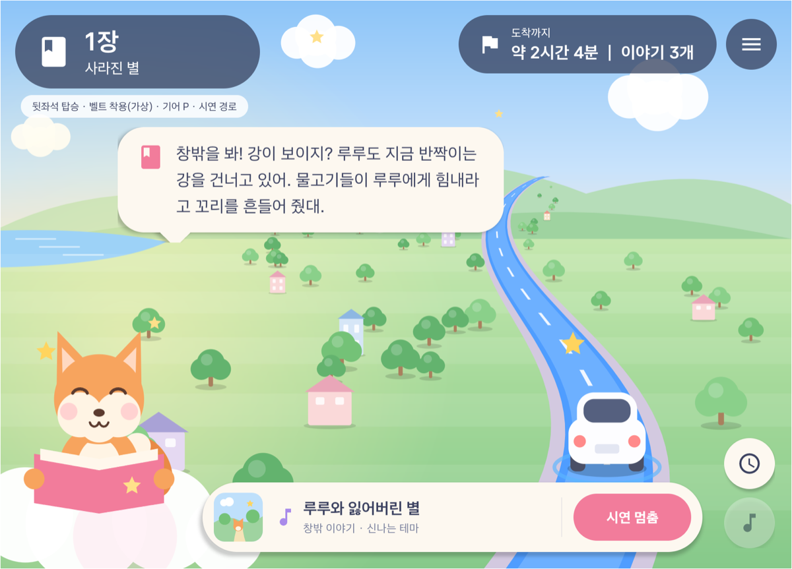

# 창밖 이야기

오늘 달리는 경로와 남은 시간에 맞춰 동화가 진행되고, 목적지에 도착하면 이야기도 함께 끝나는 뒷좌석 아이용 오디오 동화 앱입니다. (현대자동차그룹 차량용 앱 개발 공모전 출품작, Pleos Connect용)

## 실행 방법

1. Android Studio에서 이 폴더(`WindowStory`)를 엽니다.
2. Device Manager에서 `Pleos_Connect_v2.1.0` 에뮬레이터를 켭니다.
3. ▶︎(Run 'app')을 누릅니다. 터미널에서는 `./gradlew installDebug`로 설치합니다.
4. 앱에서 **시연 출발**을 누르면 서울 → 강릉 경포해변 경로가 재생되며 이야기가 진행됩니다.

디버그 APK는 빌드 후 `app/build/outputs/apk/debug/app-debug.apk`에 생깁니다.

## 테스트 환경

| 항목 | 값 |
|---|---|
| 에뮬레이터 | Pleos Connect Emulator v2.1.0 (API 34, Apple 칩) |
| 빌드 | Gradle 9.9.1, Android Gradle Plugin 9.5.1, JDK는 Android Studio 내장 |
| minSdk / targetSdk | 28 / 34 |
| SDK | Vehicle 2.3.2, NaviHelper 3.0.5, TextToSpeech 3.3.1, FusedLocation 1.1.3 |

**기어는 P로 두고 시연합니다.** 에뮬레이터에서 기어를 D로 바꾸면 직접 설치한 앱은 "주행 중에는 사용할 수 없습니다" 화면에 가려집니다(아래 "알려진 문제" 참고).

## 시연 순서

1. 버추얼 콘솔(`adb forward tcp:8088 tcp:8088` 후 http://127.0.0.1:8088)의 **Seat Occupancy**에서 Rear left를 Occupied로 바꾸면, 앱이 뒷좌석 탑승을 감지하고 인사합니다.
2. **시연 출발**을 누릅니다. 속도는 메뉴 버튼의 시연 도구에서 바꾸며, 천천히(4분)가 이야기 4장이 모두 나오는 길이입니다.
3. 경로를 따라 1~4장, 한강·터널·바다 장면, 휴게소 장면이 나옵니다.
4. 오른쪽의 **시계 버튼**(얼마나 남았어?)을 누르면 남은 시간을 이야기 단위로 답합니다.
5. 오른쪽 위 **메뉴 버튼**으로 시연 도구를 열고 **가상 벨트 풀기**를 누르면 이야기가 멈추고, 다시 누르면 이어집니다.
6. 도착하면 엔딩과 팡파르가 나옵니다.
7. 오른쪽의 **음표 버튼**(음악 취향, 정차 중에만 열림)에서 분위기, 빠르기, 악기를 고르면 테마곡과 Suno 생성 요청문이 바뀝니다.

> 이 앱은 **음성 인식을 쓰지 않습니다.** 아이는 화면의 버튼(얼마나 남았어?, 찾았어!)으로 앱과 소통하고, 이야기 낭독(TextToSpeech)만 소리로 나옵니다.

## 구조

| 파일 | 역할 |
|---|---|
| `story/Story.kt` | 이야기 데이터와 내장 이야기 「루루와 잃어버린 별」(4장) |
| `story/StoryEngine.kt` | 진행률에 맞춘 장 진행, 장소 장면, 벨트 일시정지, 남은 시간 응답 |
| `trip/NaviTripSource.kt` | NaviHelper SDK: 경로 시작, 주행 정보, 경유지·목적지 도착 |
| `trip/DemoTripSource.kt` | 시연용 경로 재생(내비와 같은 이벤트를 만듦) |
| `trip/PlaceAlerts.kt` | FusedLocation SDK 근접 알림으로 실제 주행의 장소 진입 감지 |
| `vehicle/VehicleSignals.kt` | Vehicle SDK: 뒷좌석 탑승, 안전벨트, 기어 (조회와 알림만) |
| `voice/Narrator.kt` | TextToSpeech SDK(차량 내장 엔진)로 낭독 |
| `audio/` | 테마곡·효과음 재생, 음악 취향 저장과 Suno 요청문 생성 |
| `ui/SceneView.kt` | 동화풍 배경 장면(하늘, 언덕, 길, 자동차, 이야기꾼 여우)을 코드로 그림 |
| `MainActivity.kt` | 화면 구성과 전체 연결 |

## 에뮬레이터에서 확인한 것

- 출발 → 1~4장 → 도착 엔딩까지 전체 진행 (4분 시연)
- TextToSpeech 차량 내장 엔진 낭독 (시작·완료 콜백 수신)
- Vehicle SDK의 뒷좌석 탑승 감지와 기어 조회
- 남은 시간 응답, 가상 벨트로 일시정지와 재개
- NaviHelper, FusedLocation 서비스 연결과 초기화

## 아직 확인하지 못한 것

- **실제 내비 경로 주행:** NaviHelper 서비스 연결까지만 확인했습니다. 경로 이벤트가 실제로 오는지는 확인하지 못했습니다.
- **실제 소리:** 낭독과 음악의 재생 콜백은 정상이지만, 소리를 귀로 확인하지는 못했습니다.
- **장소 근접 알림:** 등록 요청까지만 했습니다. 에뮬레이터 위치가 미국에 고정되어 있어 진입 이벤트는 확인하지 못했습니다.

## 임시로 넣어 둔 것

- **테마곡은 Suno로 만든 곡 한 곡**(`res/raw/theme_main.ogg`, "A Little Adventure Begins", 약 1분 55초)입니다. 음악 취향의 분위기를 바꿔도 같은 곡이 나옵니다. 분위기별 곡이 생기면 `audio/MusicPrefs.kt`의 `Mood`에서 곡만 각각 연결하면 됩니다. **효과음(종소리, 물소리 등)은 임시 합성음**입니다.
- **장소 좌표**(한강, 둔내터널, 경포해변)는 대략적인 값입니다. 공개 장소 API 연동 전까지 쓰는 값입니다.
- **생성형 AI 이야기 생성**은 아직 없습니다. 내장 이야기 1편으로 동작합니다.

## 알려진 문제

- **기어 D에서 앱이 가려짐:** 매니페스트에 `distractionOptimized`를 선언했는데도, 에뮬레이터에서 기어가 D이면 "주행 중에는 사용할 수 없습니다" 화면이 앱을 덮습니다. 원인은 확정하지 못했습니다. 앱 마켓을 거치지 않고 직접 설치한 앱이라 주행 중 사용 허용이 적용되지 않는 것으로 추정합니다. 운영 사무국에 문의가 필요합니다.
- **에뮬레이터의 뒷좌석 벨트 신호:** 항상 "풀림"으로 오고 버추얼 콘솔에 바꾸는 항목이 없습니다. 그래서 에뮬레이터에서는 가상 벨트 버튼으로 대신하고, 실제 차량에서는 차량 신호를 쓰도록 나눴습니다.
- **기어 조회 API:** Vehicle SDK의 기어 API는 사용 중단 예정(deprecated)으로 표시됩니다. SDK는 Android 기본 `GEAR_SELECTION` 속성 사용을 권합니다.
- **빠른 시연(1분):** 경로가 낭독보다 빨리 끝나 이야기 본문이 대부분 생략됩니다. 전체 이야기는 천천히(4분)로 시연합니다.
